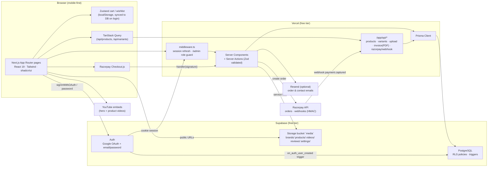
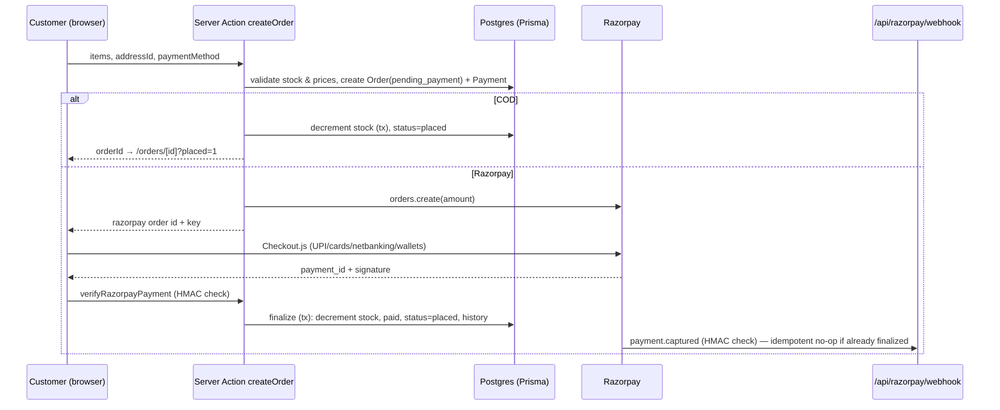
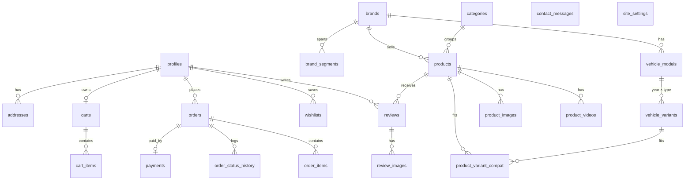

# Architecture

## Request flow: checkout

## Data model (simplified)

## Security model

| Layer         | Mechanism                                                                                                                                                                        |
| ------------- | -------------------------------------------------------------------------------------------------------------------------------------------------------------------------------- |
| Auth          | Supabase Auth (Google + email). Session cookies refreshed in `middleware.ts`.                                                                                                    |
| Roles         | `profiles.role` (`customer` / `admin`). Middleware blocks `/admin/*` for non-admins; every admin server action re-checks with `assertAdmin()`.                                   |
| RLS           | Enabled on every table (migration `0002`). Customers see only their own rows; catalogue is public-read, admin-write. Protects direct PostgREST/Storage access with the anon key. |
| Server writes | Prisma runs with the `postgres` role (bypasses RLS) **only inside server code** that performs its own auth checks and Zod validation.                                            |
| Payments      | Razorpay signature verified server-side (checkout HMAC + webhook HMAC). Stock decremented in a DB transaction _after_ verification.                                              |
| Uploads       | Browser → `/api/upload` (auth + folder ACL + MIME/size checks) → Storage via service role.                                                                                       |
| Abuse         | In-memory rate limiting on contact form, uploads, reviews, checkout.                                                                                                             |
| Secrets       | Only `NEXT_PUBLIC_*` values reach the client.                                                                                                                                    |
